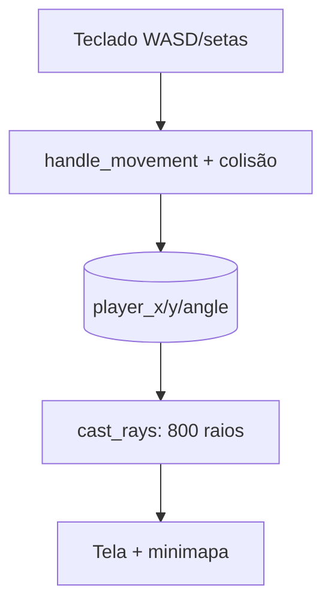

# 🕹️ Raycasting-3D-Engine — Motor 3D Tipo Wolfenstein
<p align="center">
  
  <a href="https://github.com/panda12332145/Raycasting-3D-Engine/commits/main"></a>
  <a href="https://github.com/panda12332145/Raycasting-3D-Engine"></a>
  
</p>
---
## 🔖 Resumo

**Motor de raycasting** em Python/pygame: mapa 2D de strings (`'1'`=parede) virado em 3D por **casting de raios** com FOV de 60°, projeção de colunas escaladas por profundidade, texturização com fallback automático (cor sólida) e **minimapa** sobreposto. Movimento WASD/diagonais com **colisão** por célula. Entrada `main.py` na raiz + pacote `src/` importável para testes headless.

### ✨ Funcionalidades Principais

- ✅ Casting de 1 raios por pixel de largura (800 colunas) com correção de fish-eye
- ✅ Colisão por célula (andar/strafe/diagonal) sem atravessar paredes
- ✅ Textura opcional — se `data/texture.png` faltar, fallback colorido automático
- ✅ Minimapa 2D sobreposto para depuração
- ✅ Caminho de textura baseado em `__file__` — funciona de qualquer cwd
- ✅ Testes headless com `SDL_VIDEODRIVER=dummy` (sem display)

## 📽 Demonstração

```text
$ python main.py
┌──────────────────────────────────────┐
│  WASD move · setas giram · ESC sai   │
└──────────────────────────────────────┘
```

## ⚙️ Explicação das Partes Importantes

### Casting de um raio (`src/renderer.py`)

```python
ray_angle = player_angle - radians(FOV/2) + radians(FOV) * (ray / WIDTH)
for depth in range(1, 800):
    tx = int(player_x + depth * cos_a)
    if MAP[ty // TILE][tx // TILE] == "1":
        depth *= cos(player_angle - ray_angle)   # corrige fish-eye
        height = min(TILE * 400 / depth, HEIGHT)
```

> A correção `cos(ângulo relativo)` aplana a distorção do peixe; a altura inversa à distância dá o efeito de perspectiva.

### Fallback de textura

```python
except Exception:
    texture = pygame.Surface((TILE, TILE))
    texture.fill((180, 80, 50))        # funciona sem nenhum asset
```

> O jogo nunca quebra por imagem faltando — asset vira opcional.

## 🔄 Fluxo de Trabalho / Arquitetura



## 📂 Estrutura do Projeto

```plaintext
Raycasting-3D-Engine/
├── main.py               # entrada do jogo
├── src/
│   ├── main.py           # loop, eventos, movimento
│   ├── renderer.py       # raycasting + minimapa
│   └── world.py          # mapa, TILE, is_wall
├── tests/test_engine.py  # 4 testes headless
├── requirements.txt      # pygame
└── README.md
```

## 🛠️ Tecnologias

| Ferramenta | Uso |
|---|---|
| **Python 3** | Linguagem |
| **pygame** | Renderização/entrada |
| **Raycasting** | Técnica 3D dos anos 90 |

## ▶️ Instalação

```bash
git clone https://github.com/panda12332145/Raycasting-3D-Engine.git
cd Raycasting-3D-Engine
pip install -r requirements.txt
```

## 🚀 Execução

```bash
# Jogo:
python main.py

# Testes (sem display):
python tests/test_engine.py
```

## 🧪 Testes

4 testes automatizados: colisão/bordas do mapa, 800 colunas desenhadas com pixels pintados, empurrão contínuo contra parede sem sair do mapa e smoke de frames em 4 ângulos (headless).

## ⚠️ Limitações

- Sem sprites/inimigos/pausa (só paredes + minimapa)
- Mapa fixo em `world.py` (edite o array para novas fases)
- Uma textura global — sem paredes com materiais diferentes

## 🚀 Roadmap

- [ ] Sprites 2D projetados (inimigos/itens)
- [ ] Múltiplas texturas por célula
- [ ] Editor de mapa simples
- [ ] Minimapa com campo de visão

## 📄 Licença

Todos os direitos reservados ao autor.

---

## 👾 Autor

<p align="center">
  
</p>

<p align="center">Feito por <strong>Panda12332145</strong> 👋🏽</p>

---

## 🧑‍💻 Sobre Mim

Sou apaixonado por **Física Teórica, Cibersegurança e Desenvolvimento de Sistemas**. Tenho grande interesse em programação de baixo nível, engenharia reversa, automação, sistemas Windows, criptografia e segurança ofensiva. Também gosto bastante de música, filosofia e computação avançada.

---

## 🌐 Redes

* **Site:** [https://panda-h0me.netlify.app/](https://panda-h0me.netlify.app/)
* **YouTube:** [https://www.youtube.com/@X86BinaryGhost](https://www.youtube.com/@X86BinaryGhost)
* **Instagram:** [https://www.instagram.com/01pandal10/](https://www.instagram.com/01pandal10/)
* **GitHub:** [https://github.com/panda12332145](https://github.com/panda12332145)
* **LinkedIn:** [linkedin.com/in/athos-da-boanergis](https://www.linkedin.com/in/athos-d%C3%A3-boanergis-5585a4288/)

---

## 🚀 Áreas de Interesse

* **Cibersegurança Avançada** 🔒
* **Hacking & Engenharia Reversa** 💻
* **Computação de Baixo Nível** 🖥️
* **Matemática e Física Teórica** 📐⚛️
* **Desenvolvimento de Ferramentas de Segurança** 🛠️

_"Conhecimento é poder, e domínio técnico vem da compreensão profunda dos sistemas."_

---

## 📞 Contato & Suporte

Para colaborações, dúvidas ou sugestões:

📧 **E-mail:** [athos.cybersec@gmail.com](mailto:athos.cybersec@gmail.com)

🐛 **Reportar Bug:** [Abrir Issue](https://github.com/panda12332145/Raycasting-3D-Engine/issues)

💡 **Sugerir Melhoria:** [Discussions](https://github.com/panda12332145/Raycasting-3D-Engine/discussions)
